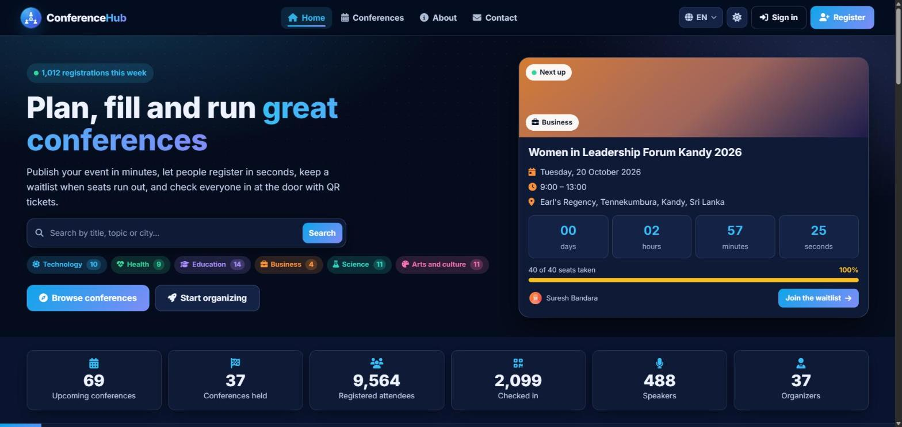
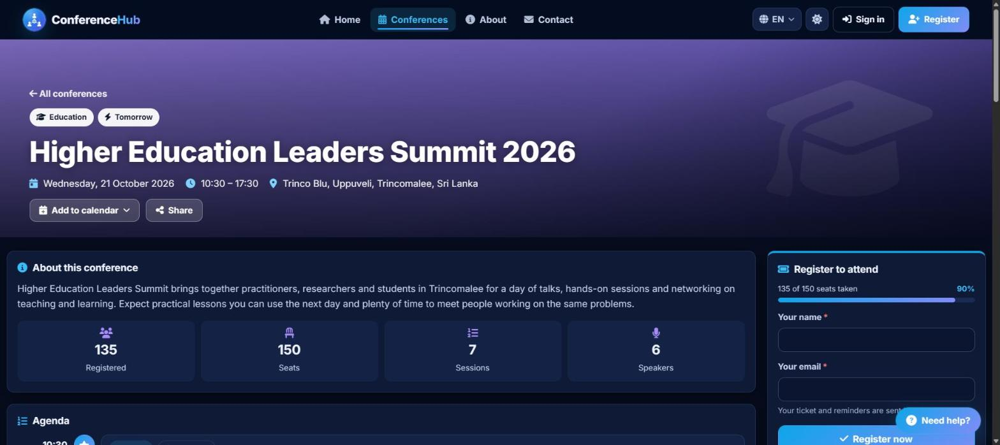
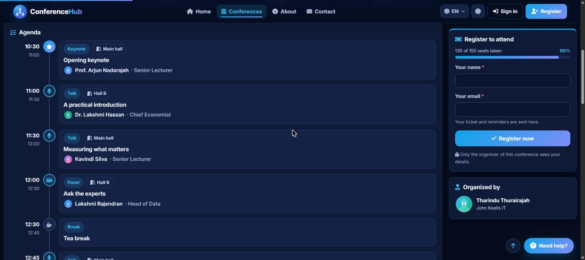
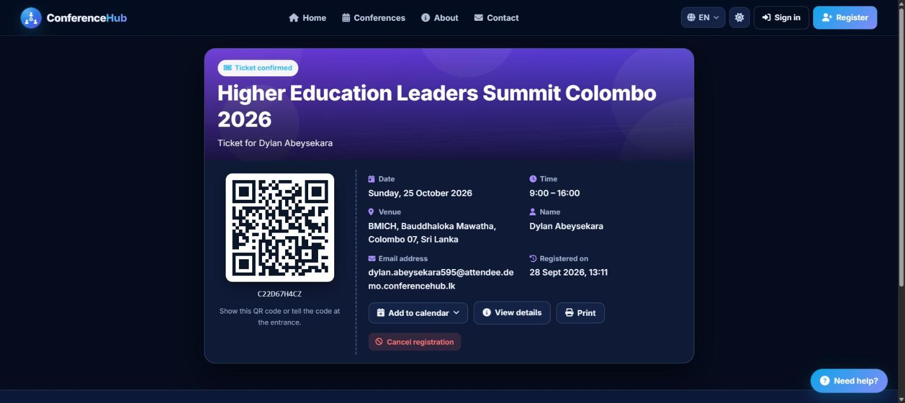
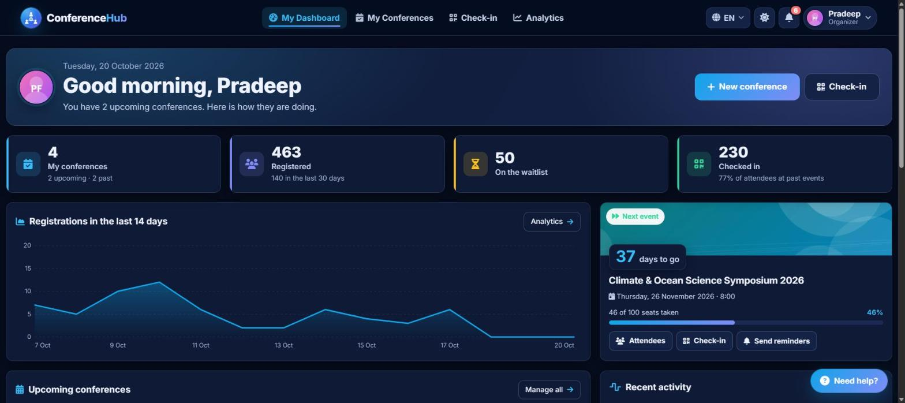
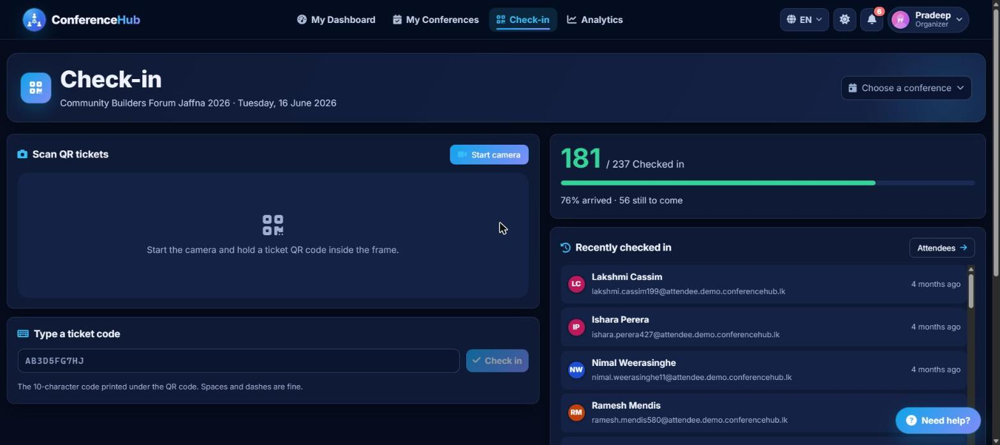
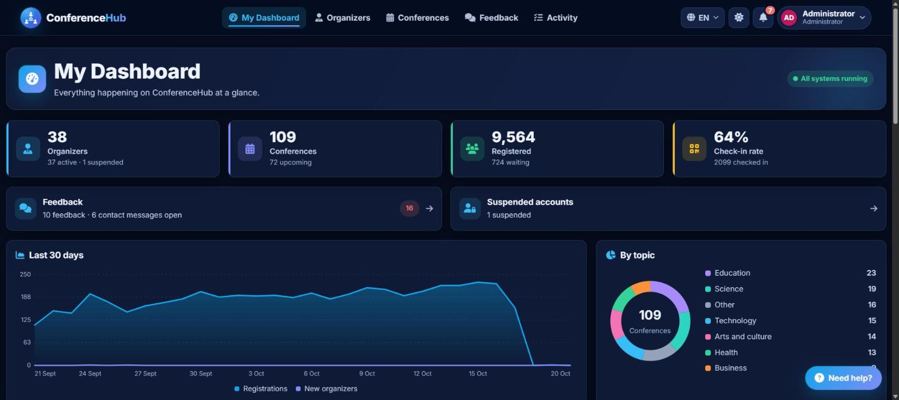
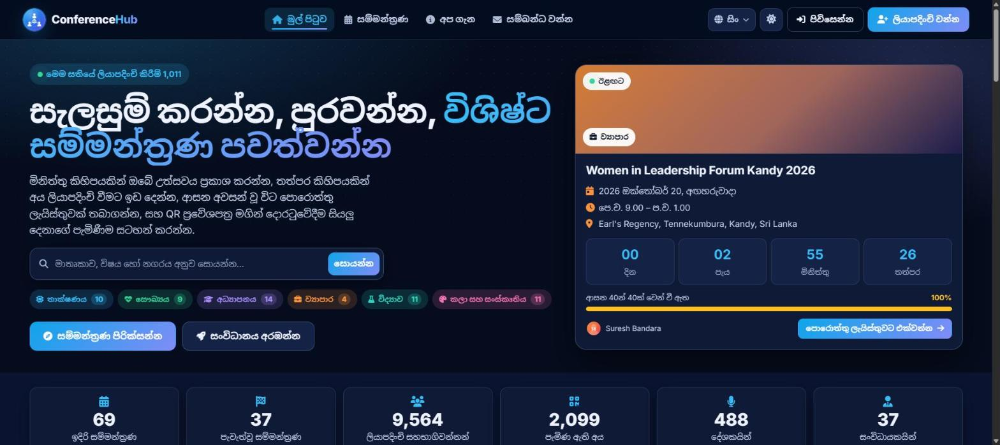

<p align="center"></p>

# ConferenceHub — Conference Registration & QR Check-in Platform for Sri Lanka

**FastAPI · React + TypeScript · PostgreSQL** | Three roles | Waitlists | QR tickets & check-in | Email codes | Trilingual (English / සිංහල / தமிழ்)

Full-stack web application for running conferences in Sri Lanka. Organizers publish events with a cover, agenda, speakers and a venue map; attendees register in seconds without an account, confirm their email with a 6-digit code and get a QR ticket; a waitlist fills free seats automatically; and the check-in desk scans tickets with any phone camera. Administrators oversee every organizer, conference and message. Every page, email and notification works in English, Sinhala and Tamil.

---

## Screenshots

**Home** — the next event with a live countdown, platform numbers and topics



**Conference page** — cover, details, seats left and registration in one place



**Agenda and speakers** — a timeline of sessions with rooms and speakers



**QR ticket** — shown after the attendee confirms the emailed code; add to calendar or cancel



**Organizer dashboard** — registrations, waitlist, check-ins and the next event at a glance



**Check-in desk** — scan QR tickets with any camera or type the code, with a live arrival counter



**Admin dashboard** — platform statistics, trends, topics and cities



**Sinhala and Tamil** — every page, email and notification in three languages



**More:** the conference editor (agenda, speakers, venue map), attendee list, analytics, notifications, settings, help and guided tours, light mode, Tamil, and every admin page are in the **[full screenshot gallery](SCREENSHOTS.md)**.

---

## Quick Start

### One command (recommended, Windows)

```bash
copy backend\.env.example backend\.env
```

Edit `backend\.env` (at least `DATABASE_URL`, `SECRET_KEY` and `ADMIN_INITIAL_PASSWORD`), then double-click **`setup.bat`**. It creates `backend\.venv` with the exact package versions, creates the database, installs the frontend and starts everything.

After that, use **`start-services.bat`** and **`stop-services.bat`**. The start script checks that setup was done and the ports are free, opens the backend and frontend in their own windows and waits until both answer. The stop script closes those windows and frees the ports without touching other projects. Add `/q` to either script to skip the final "Press any key".

- App: http://localhost:5174
- API docs: http://localhost:8002/docs

### Manual start (2 terminals)

**Terminal 1 — Backend API (port 8002)**
```bash
cd backend
python -m venv .venv
.venv\Scripts\pip install -r requirements.txt
.venv\Scripts\python -m uvicorn app.main:app --host 127.0.0.1 --port 8002
# migrations run automatically at startup · http://localhost:8002/docs
```

**Terminal 2 — Frontend (port 5174)**
```bash
cd frontend
npm install
npm run dev
# http://localhost:5174
```

### Docker

```bash
copy backend\.env.example backend\.env
docker compose up --build
```

Compose runs PostgreSQL, the API (with a volume for uploaded images) and the frontend on the same ports.

### Prerequisites

- Python 3.12+ (CI and Docker use 3.14)
- Node.js 22+
- PostgreSQL — the database in `DATABASE_URL` (default `conference_db`)

### Demo data

Fill the database with 36 organizers, about 100 past and upcoming conferences (some happening today, a dozen this week, a few written in Sinhala or Tamil), speakers with photos, agendas, about 10,000 registrations with waitlists and check-ins, feedback and contact messages:

```bash
cd backend
.venv\Scripts\python -m scripts.seed_demo --yes --password "choose-a-demo-password"
```

Remove all of it again. Real accounts are never touched, and demo accounts use `@demo.conferencehub.lk` addresses, which are never emailed:

```bash
.venv\Scripts\python -m scripts.seed_demo --remove --yes
```

Take a backup with `pg_dump` first if the database holds real data.

---

## CI

GitHub Actions (`.github/workflows/ci.yml`) runs on every push and pull request to `master`:

- **Backend:** Ruff, Alembic migrations against a real PostgreSQL 16 (upgrade, downgrade, upgrade again), and the pytest suite.
- **Frontend:** ESLint, the TypeScript type check, the Vitest suite and a production `vite build`.

Backend tests use their own temporary SQLite database and never touch PostgreSQL.

---

## Architecture

| Layer | Port | Technologies |
|---|---|---|
| Backend API | 8002 | Python · FastAPI · Uvicorn · SQLAlchemy 2 · Alembic · PostgreSQL · JWT · Pillow · aiosmtplib (Gmail) · SlowAPI rate limits |
| Frontend | 5174 | React 18 · TypeScript · Vite 6 · React Router 6 · Leaflet + OpenStreetMap · qrcode / jsQR · Vitest |

A background job in the API sends day-before reminders and releases seats held by registrations nobody confirmed in time.

---

## User Roles

| Role | Access | How created |
|---|---|---|
| **Attendee** | Browse and search conferences, register, confirm by email code, QR ticket, add to calendar, cancel | No account needed |
| **Organizer** | Dashboard, conference editor (cover, agenda, speakers, map), attendees, check-in desk, analytics, settings, help and feedback | Self-register at `/register`, then verify the email with a 6-digit code |
| **Admin** | Platform dashboard and analytics, organizers (suspend, restore, delete), all conferences, feedback and contact messages, activity log | Created automatically on first start from `ADMIN_EMAIL` and `ADMIN_INITIAL_PASSWORD` |

---

## Features

**Attendees** (no account needed)
- Browse and search conferences by topic, city and date; upcoming and past
- Register in seconds; join a waitlist automatically when a conference is full
- Confirm the email address with a 6-digit code: the seat is held for 24 hours, and the ticket works once confirmed
- Ticket page with a QR code, add to calendar (Google Calendar or `.ics`) and self-cancel
- Confirmation, ticket and day-before reminder emails in the language they registered in

**Organizers**
- Dashboard with live numbers, a 14-day trend, next-event countdown, recent activity and a getting-started checklist
- Conference editor with a live preview: details, cover image, venue pin on an OpenStreetMap map, agenda sessions and speakers with photos; drafts stay hidden until published
- Seat limits with automatic promotion from the waitlist when someone cancels or the limit is raised
- Attendee list with manual check-in, CSV export and "send reminders now"
- Check-in desk: scan QR tickets with any camera (or type the code), live arrival counter, duplicate and unconfirmed tickets flagged
- Analytics: registrations and check-ins over time, by weekday, by topic and per conference
- Profile photo, settings, help centre with guided "Need help?" tours, and feedback to the admin team

**Administrators**
- Dashboard with platform analytics: trends, topics, conferences by month, top cities, top organizers and conferences
- Organizer management (search, suspend, restore, delete); suspended organizers' conferences are hidden from the public
- All conferences with filters; feedback replies (emailed to the organizer) and contact-form messages
- Activity log of sign-ins, edits and admin actions

**Notifications & email**
- In-app notification bell with unread count, "mark as seen" and "mark all as seen"
- Organizers hear about confirmed registrations, full conferences, cancellations and waitlist promotions
- Branded HTML emails through Gmail SMTP in English, Sinhala or Tamil; the code appears in the subject line
- Without Gmail credentials, emails and codes are written to the server log, so development needs no email account

**Auth & security**
- Email verification with 6-digit codes (stored as an HMAC, 15 minutes, 5 tries, resend once a minute)
- Forgot / reset password with single-use, time-limited links
- JWT sessions, role-protected pages, rate limits on sign-in, registration and codes
- Uploads limited to JPG / PNG / WebP (2 MB photos, 5 MB covers), checked and re-encoded on the server

**Everywhere**
- Full trilingual UI: English / සිංහල / தமிழ් (including Sinhala dates, which Chrome does not provide)
- Light and dark themes, large readable text, keyboard support, responsive down to phone width
- Custom dropdowns, date and time pickers that follow the theme

---

## Email configuration (`backend/.env`)

| Variable | Description |
|---|---|
| `GMAIL_USER` | Gmail address that sends the emails (e.g. `admin.conferencehub@gmail.com`) |
| `GMAIL_APP_PASSWORD` | A Google **app password** (needs 2-Step Verification), not the normal Gmail password |
| `FRONTEND_URL` | Base of links in emails (default `http://localhost:5174`) |
| `VERIFY_CODE_MINUTES` | How long an emailed 6-digit code works (default 15) |
| `CONFIRM_HOLD_HOURS` | How long an unconfirmed registration holds its seat (default 24) |
| `EMAIL_BLOCKED_DOMAINS` | Domains never emailed (default `demo.conferencehub.lk`, the demo data) |

> **Dev tip:** leave `GMAIL_USER` and `GMAIL_APP_PASSWORD` empty and the codes are printed in the backend window. With them set, check the setup with `python -m scripts.send_test_email you@example.com`.

## Other settings

| Variable | Required | Description |
|---|---|---|
| `DATABASE_URL` | Yes | PostgreSQL connection string |
| `SECRET_KEY` | Yes | Long random string for signing sign-in tokens and codes |
| `ADMIN_EMAIL` | No | Administrator sign-in email (default `admin.conferencehub@gmail.com`) |
| `ADMIN_INITIAL_PASSWORD` | Yes on first start | Administrator password when the account is first created |
| `ACCESS_TOKEN_EXPIRE_MINUTES` | No | Session length (default 1440) |
| `UPLOAD_DIR` | No | Where images are stored (default `backend/uploads`) |
| `REMINDER_INTERVAL_SECONDS` | No | How often the reminder job runs (default 900) |

Real environment variables take priority over `backend/.env`.

---

## Quality checks

```bash
cd backend
.venv\Scripts\ruff check .
.venv\Scripts\python -m pytest
.venv\Scripts\python -m scripts.check_integrity   # read-only database health check
```

```bash
cd frontend
npm run lint
npm run typecheck
npm test
npm run build
```

---

## Project structure

```
backend/
  app/api/          sign-in, registration, email codes, password reset
  app/core/         settings, errors, uploads, email (+ Sinhala/Tamil texts), codes, notifications, reminders
  app/models/       SQLAlchemy models
  app/routers/      conferences, agenda, attendees + tickets, organizers, notifications, public, admin
  alembic/          database migrations
  scripts/          seed_demo.py, check_integrity.py, send_test_email.py
  tests/            pytest suite
frontend/
  src/components/   navbar, notification bell, custom select, date picker, code entry, charts, map, QR, tour
  src/i18n/         en.ts, si.ts, ta.ts, date formatting
  src/pages/        public, auth, organizer and admin pages
  src/services/     typed API client
  src/test/         Vitest suite
screenshots/        README and gallery images
```

---

## Accounts (local only)

| Role | Email |
|---|---|
| Admin | `admin.conferencehub@gmail.com` (password from `ADMIN_INITIAL_PASSWORD`) |
| Demo organizers | `firstname.lastname@demo.conferencehub.lk` (password chosen when seeding) |
| Organizers | create your own at `/register` |

Passwords are not listed here because this repository is public.

---

## Creator

Designed and built by **[Induwara Ihalavithana](https://github.com/InduwaraIhalavithana)**.

Questions or partnership ideas: admin.conferencehub@gmail.com
