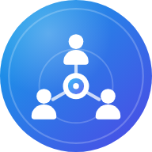
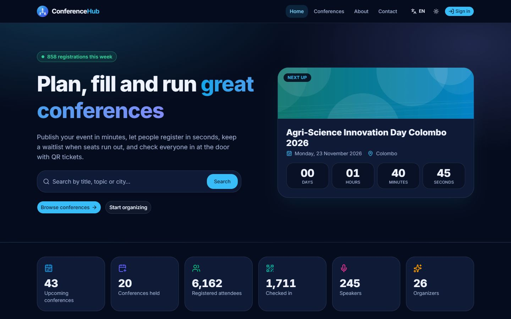
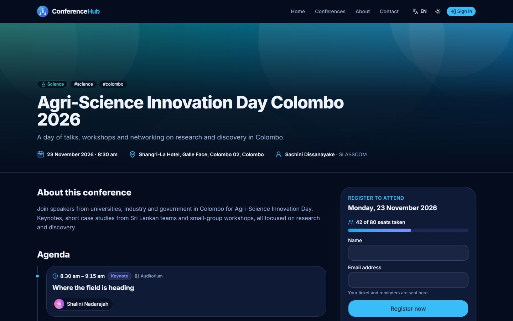
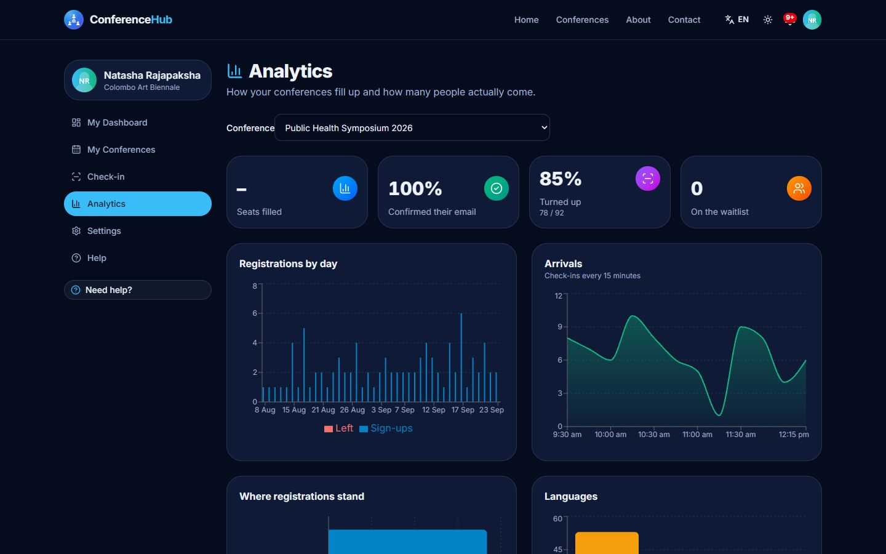
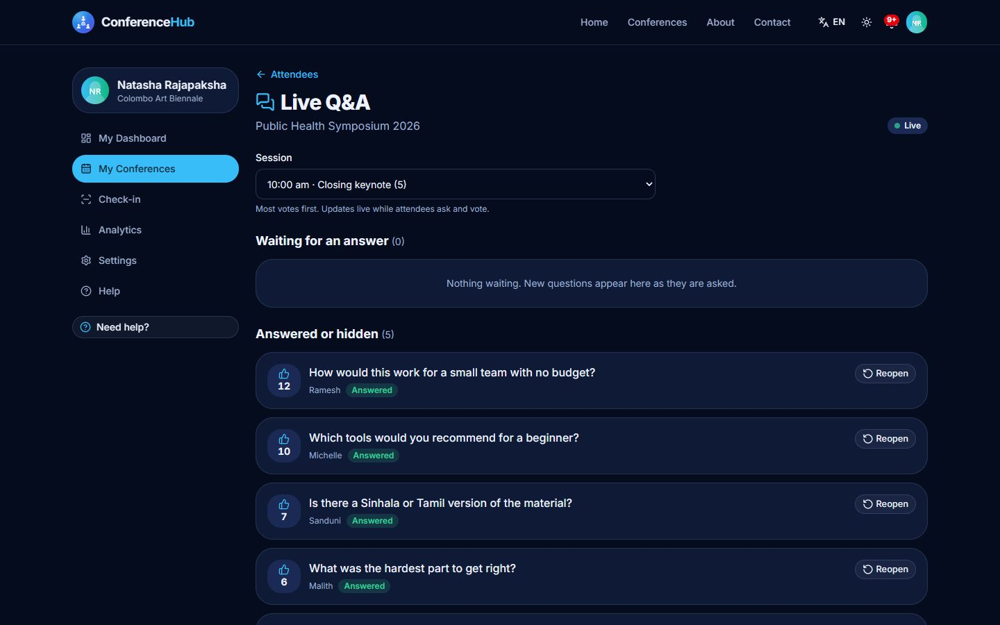
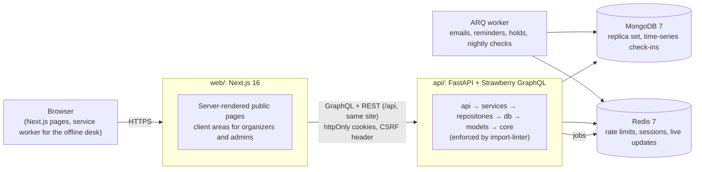

<p align="center"></p>

# ConferenceHub: conference registration and QR check-in for Sri Lanka

**FastAPI · GraphQL · MongoDB · Redis · Next.js 16 · TypeScript** | Waitlists | QR tickets and an offline check-in desk | Live Q&A | Trilingual (English / සිංහල / தமிழ்)

Organizers publish conferences with an agenda, speakers and a venue map. Attendees register in seconds without an
account, confirm with an emailed code and get a QR ticket; a waitlist fills free seats automatically. At the door,
any phone scans tickets, even offline. During the event, ticket holders ask the speakers questions live; afterwards
they rate the sessions. Administrators oversee every organizer, conference and message. Every page, email and
notification works in English, Sinhala and Tamil.

**More projects:** [induwara-ihalavithana.vercel.app](https://induwara-ihalavithana.vercel.app)

<p align="center">
  
  
</p>

---

## What it does

**Attendees** (no account)
- Browse and search conferences by topic, city and date, or on a map; upcoming and past.
- Register in seconds, confirm the email with a 6-digit code (the seat is held for 24 hours), or join the waitlist.
- Ticket page: QR code, add to calendar, cancel, **My agenda** (save sessions, each to your calendar).
- **Live Q&A:** ask the speakers questions and upvote others', live.
- **Feedback:** after check-in, rate each session and the conference; a reminder email comes the day after.

**Organizers**
- Dashboard, conference editor (details in three languages, multi-day agendas with tracks, speakers, cover, venue pin).
- Attendees with filters, CSV export and reminders; seats move up from the waitlist automatically.
- **Check-in desk:** camera or typed codes, live numbers from every desk, keeps working offline and syncs later.
- **Analytics:** sign-ups by day, 15-minute arrivals, fill and turn-up, and anonymous attendee feedback.
- **Live Q&A moderation:** questions by votes, live; mark answered or hide.
- Notifications, settings, help with guided tours, feedback to the admin team.

**Administrators**
- Platform numbers, organizers (suspend, restore, delete), every conference (hide or show), inbox for contact
  messages and organizer feedback, activity log, and a System page (database, cache, worker, scheduled jobs).

<p align="center">
  
  
</p>

More screenshots: [docs/screenshots](docs/screenshots) (home in Sinhala, browse, ticket, organizer dashboard,
editor, check-in desk, feedback).

---

## Architecture



- **Layers:** each layer of the API imports only the ones below it, and CI checks that the API layer never touches
  the database directly and that business rules never depend on the web framework.
- **Seats are never overbooked:** a seat is taken by one conditional, atomic update inside a MongoDB transaction.
- **Live updates** (check-in desk, live Q&A) go through Redis pub/sub as server-sent events.
- **Background work** (emails in three languages, reminders, releasing unconfirmed holds, the day-after feedback
  email, nightly self-checks) runs in an ARQ worker.
- Decisions and their reasons: [docs/adr](docs/adr). The API reference: [docs/graphql-schema.md](docs/graphql-schema.md),
  generated from the code. Security: [docs/security-checklist.md](docs/security-checklist.md) maps the OWASP Top 10
  to this app. What changed when: [CHANGELOG.md](CHANGELOG.md).

| Folder | What is in it |
|---|---|
| [`api/`](api) | FastAPI + Strawberry GraphQL + Beanie (MongoDB) + ARQ worker, with its own [README](api/README.md) |
| [`web/`](web) | Next.js 16 + TypeScript + Tailwind + shadcn/ui + next-intl, with its own [README](web/README.md) |
| [`docs/`](docs) | Decision records, the GraphQL reference, the security checklist and screenshots |
| [`branding/`](branding) | Logo files |
| `docker-compose.dev.yml` | MongoDB (replica set) and Redis for local development |

---

## Run it locally

Needs Docker, [uv](https://docs.astral.sh/uv/) (Python 3.13) and Node 22.

```bash
docker compose -f docker-compose.dev.yml up -d          # MongoDB + Redis

cd api
cp .env.example .env                                     # set SECRET_KEY and ADMIN_INITIAL_PASSWORD
uv sync
uv run python -m scripts.seed_demo --yes --password "<choose one>"   # optional: realistic demo data
uv run uvicorn app.main:app --port 8003                  # API (GraphiQL at /graphql)
uv run arq app.worker.WorkerSettings                     # worker, in a second terminal

cd ../web
npm install
npm run dev                                              # http://localhost:3100
```

Emails go to the API log unless Gmail credentials are set (`api/.env`); demo and example addresses are never
emailed. The admin signs in at `/admin/login` with `ADMIN_EMAIL` and the password from `ADMIN_INITIAL_PASSWORD`.

## Tests and CI

| | Command | What |
|---|---|---|
| API | `uv run pytest -q` | 168 tests against real MongoDB and Redis |
| API | `uv run ruff check . && uv run mypy . && uv run lint-imports` | lint, strict types, architecture rules |
| Web | `npm run lint && npm run typecheck && npm test` | ESLint, TypeScript, Vitest (translations complete, formatting) |
| Web | `npm run e2e` | Playwright + axe accessibility checks, against a running site |

GitHub Actions runs all of these on every pull request, plus a production build, `pip-audit` and `npm audit`, and
Lighthouse (performance, accessibility, best practices and SEO each at least 90 on desktop).

---

## Versions

This is **v3**, a rewrite built phase by phase and merged into `master` on 2026-11-23 (see the [changelog](CHANGELOG.md)).
v2 (FastAPI + SQLAlchemy + PostgreSQL + React/Vite) is kept at the [`v2-final`](../../tree/v2-final) tag.

## Creator

Designed and built by **[Induwara Ihalavithana](https://github.com/InduwaraIhalavithana)**.

## License

The code is released under the [MIT License](LICENSE). The license covers the source code only: the creator's photo
(`web/public/creator.webp`) and the ConferenceHub name and logo (`branding/`, `web/public/logo.svg`,
`web/public/apple-touch-icon.png`) are not covered and may not be reused without permission.
