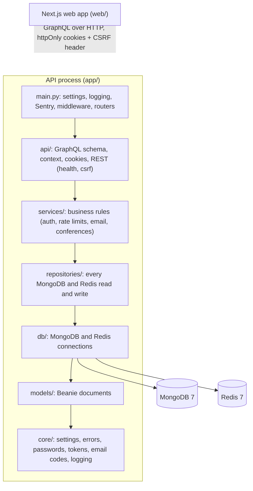

# ConferenceHub v3 API

Async FastAPI + Strawberry GraphQL + MongoDB (Beanie) + Redis, on Python 3.13 with uv. Work in progress on the `v3` branch; v2 lives in `../backend`.

## Run it

```bash
docker compose -f ../docker-compose.dev.yml up -d     # MongoDB (replica set) + Redis
cp .env.example .env                                  # then set SECRET_KEY and ADMIN_INITIAL_PASSWORD
uv sync
uv run python -m scripts.seed_spike                   # sample conferences
uv run uvicorn app.main:app --port 8003 --reload      # GraphiQL at http://localhost:8003/graphql
```

Checks (the same ones CI runs):

```bash
uv run ruff check . && uv run ruff format --check .
uv run mypy app scripts tests        # strict
uv run lint-imports                  # architecture rules below
uv run pytest -q                     # needs the Docker MongoDB and Redis
```

## Architecture



Each layer may only import the layers below it, and two extra rules are checked by `lint-imports` in CI:

- the API layer never imports repositories, the database layer, Beanie, PyMongo or Redis: it calls services;
- services, repositories, models and core never import FastAPI, Starlette or Strawberry, so the rules can be reused from a worker or a script.

Patterns in use: **Repository** (`repositories/`), **Strategy** (`services/email.py`: log, memory and, from Phase 3, SMTP senders), **typed errors as data** (`DomainError` in services becomes a `UserError` member of each mutation's result union).

## Auth in short

- Organizers sign up and enter a 6-digit emailed code (15 minutes, 5 tries, resend once a minute; only an HMAC is stored).
- Sign-in sets two **httpOnly, SameSite=Lax** cookies: a 15-minute access token and a 30-day refresh token (PyJWT).
- Each sign-in is a session document in MongoDB. The refresh token is **rotated on every use**; presenting an old one revokes the session (reuse detection).
- Every mutation needs the `X-CSRF-Token` header to match the `cm_csrf` cookie (`GET /auth/csrf` sets it).
- Passwords are **Argon2id**; v2's PBKDF2 hashes are accepted once and upgraded at the next sign-in.
- Changing or resetting a password signs out every other device. Suspending an organizer signs them out at once.
- The admin is created on first start from `ADMIN_EMAIL` and `ADMIN_INITIAL_PASSWORD` (environment only, never logged).
- Rate limits per IP on sign-in, sign-up, codes and resets (Redis).

See [`../docs/security-checklist.md`](../docs/security-checklist.md) for the OWASP Top 10 mapping and [`../docs/adr`](../docs/adr) for the decision records.
