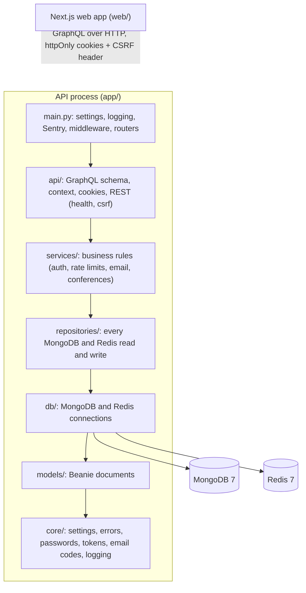

# ConferenceHub v3 API

Async FastAPI + Strawberry GraphQL + MongoDB (Beanie) + Redis, on Python 3.13 with uv. Work in progress on the `v3` branch; v2 lives in `../backend`.

## Run it

```bash
docker compose -f ../docker-compose.dev.yml up -d     # MongoDB (replica set) + Redis
cp .env.example .env                                  # then set SECRET_KEY and ADMIN_INITIAL_PASSWORD
uv sync
uv run python -m scripts.seed_spike                   # sample conferences
uv run uvicorn app.main:app --port 8003 --reload      # GraphiQL at http://localhost:8003/graphql
```

Checks (the same ones CI runs):

```bash
uv run ruff check . && uv run ruff format --check .
uv run mypy app scripts tests        # strict
uv run lint-imports                  # architecture rules below
uv run pytest -q                     # needs the Docker MongoDB and Redis
```

## Architecture



Each layer may only import the layers below it, and two extra rules are checked by `lint-imports` in CI:

- the API layer never imports repositories, the database layer, Beanie, PyMongo or Redis: it calls services;
- services, repositories, models and core never import FastAPI, Starlette or Strawberry, so the rules can be reused from a worker or a script.

Patterns in use: **Repository** (`repositories/`), **Strategy** (`services/email.py`: log, memory and, from Phase 3, SMTP senders), **typed errors as data** (`DomainError` in services becomes a `UserError` member of each mutation's result union).

## Auth in short

- Organizers sign up and enter a 6-digit emailed code (15 minutes, 5 tries, resend once a minute; only an HMAC is stored).
- Sign-in sets two **httpOnly, SameSite=Lax** cookies: a 15-minute access token and a 30-day refresh token (PyJWT).
- Each sign-in is a session document in MongoDB. The refresh token is **rotated on every use**; presenting an old one revokes the session (reuse detection).
- Every mutation needs the `X-CSRF-Token` header to match the `cm_csrf` cookie (`GET /auth/csrf` sets it).
- Passwords are **Argon2id**; v2's PBKDF2 hashes are accepted once and upgraded at the next sign-in.
- Changing or resetting a password signs out every other device. Suspending an organizer signs them out at once.
- The admin is created on first start from `ADMIN_EMAIL` and `ADMIN_INITIAL_PASSWORD` (environment only, never logged).
- Rate limits per IP on sign-in, sign-up, codes and resets (Redis).

## Conferences in short (Phase 2)

- A conference is **one MongoDB document**: text in English, Sinhala and Tamil, category, tags, venue with a GeoJSON point, dates over up to 14 days, and its tracks, speakers and sessions inside it.
- Organizers create drafts, edit, publish (refused with the reasons until it is complete), unpublish, cancel, delete and duplicate them. Only the owner can see a draft or change anything; someone else's conference answers like a missing one.
- Agenda rules: sessions fall on a conference day, start and end on the same day, use existing speakers and tracks, and never share a room at the same time. Removing a speaker or track updates the sessions that used it.
- Saves use a revision check, so two editors cannot silently overwrite each other.
- Public queries: `conferences(filter, first, after)` with Relay cursors (soonest first, or nearest first with `near`), `conference(slug)`. Text search covers all three languages. Organizer names come through a **DataLoader**, one query per page instead of one per conference.
- Search sits behind a **Strategy** (`repositories/conference_search.py`): MongoDB's text and 2dsphere indexes now, Atlas Search can slot in later.
- Images: `POST /upload?kind=cover|speaker` (signed in, CSRF header), re-encoded to WebP without metadata, served from `/uploads`. Replaced or deleted images are removed; duplicated conferences get their own copies.

## Registrations, the worker and email (Phase 3)

- **Seats can never be overbooked.** A seat is taken by one atomic, conditional increment (`counters.registered < capacity`) inside a MongoDB transaction (`repositories/unit_of_work.py`, the **Unit of Work** pattern). A test fires 200 registrations at once at 25 seats: exactly 25 get a seat and the rest are waitlisted.
- Attendees need no account. A new registration **holds** its seat for 24 hours until the emailed 6-digit code is entered. Waitlisters confirm too, and only confirmed waitlisters move up, oldest first.
- The 12-character ticket code (no 0/O or 1/I/L) is the key to the ticket: view it, resend the code, cancel.
- Organizers (owner only): attendee list with filters and cursors; check-in by ticket code with duplicates flagged; undo; remove an attendee; "send reminders now"; CSV export at `GET /conferences/{id}/attendees.csv`, safe against spreadsheet formula injection.
- Check-ins are also written to a MongoDB **time-series collection** (`checkin_events`) for the arrival charts in Phase 5.
- Anyone can download a calendar file at `GET /conferences/{slug}/calendar.ics`.
- Conference saves never write the seat counters back, so an edit can never undo registrations made since the page was loaded.

**The worker** is a second process (ARQ, an async job queue in Redis):

```bash
uv run arq app.worker.WorkerSettings
```

- Emails are queued by the API and sent by the worker through Gmail SMTP, with up to 3 tries. They are rendered in the reader's language (EN/SI/TA, Jinja2 with auto-escaping).
- Without `GMAIL_USER` / `GMAIL_APP_PASSWORD`, emails go to the worker's log instead, codes included.
- Demo and example domains are never emailed.
- Set `EMAIL_DELIVERY=log` to skip the worker entirely in development.
- Scheduled jobs, each safe to run twice:

| Job | When |
|---|---|
| Release expired holds and promote the waitlist | every 10 minutes |
| Day-before reminders | hourly |
| Recount seat counters and fix any drift | nightly |
| Delete organizers who never verified their email (after 7 days) | nightly |
| Delete uploaded images nothing uses (after a day) | nightly |

Sample data: `uv run python -m scripts.seed_spike` adds two published conferences with agendas and one draft; `--remove` deletes them.

See [`../docs/security-checklist.md`](../docs/security-checklist.md) for the OWASP Top 10 mapping and [`../docs/adr`](../docs/adr) for the decision records.

## Moving the v2 data (Phase 8)

`scripts/migrate_v2.py` moves v2's organizers (with their password hashes and photos), the admin's password hash,
and the notifications and activity that belong to them, from a JSON export of the v2 PostgreSQL tables. It is a dry
run unless `--yes` is given, never moves the same organizer twice, and refuses a production database without
`--production`. The export holds password hashes, so keep it in the git-ignored `backups/` folder.

```
# read-only on v2: one JSON array per table
psql "$V2_URL" -At -c "select coalesce(json_agg(row_to_json(t)), '[]'::json) from organizers t" > ../backups/v2-export/organizers.json
# (the same for admins, notifications, activity_logs, feedback, contact_messages)

uv run python -m scripts.migrate_v2 ../backups/v2-export --uploads ../backend/uploads         # dry run
uv run python -m scripts.migrate_v2 ../backups/v2-export --uploads ../backend/uploads --yes   # write
```

Moved organizers sign in with their v2 password; it is upgraded to Argon2 at that sign-in. Rows about test or
deleted accounts stay behind in the v2 backup.
